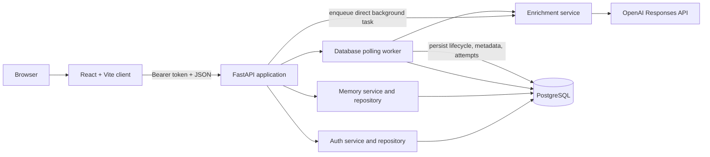
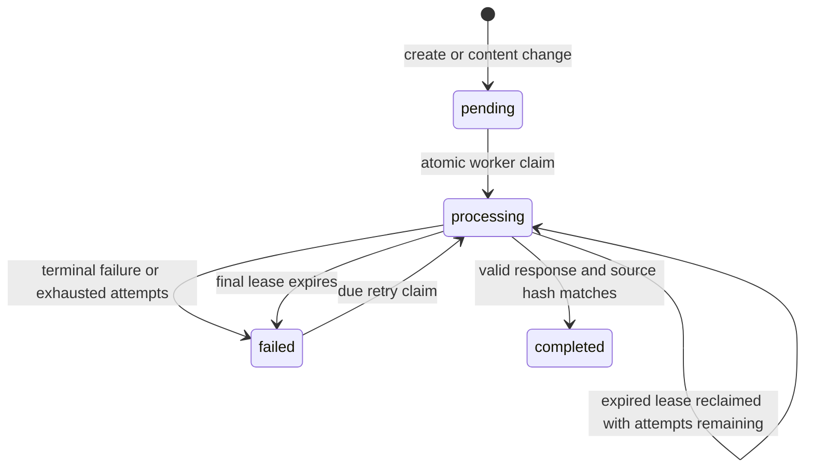
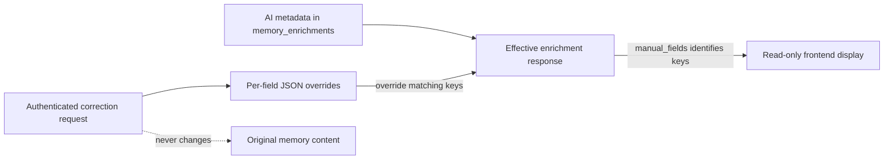

# Aura architecture

## Supported runtime

The supported backend is the Python + FastAPI application in `apps/api/app`. The TypeScript/Fastify bootstrap in `apps/api/src` is legacy reference code and is not a supported startup path. FastAPI generates the interactive API reference at `/docs` and its OpenAPI schema at `/openapi.json`.

## System architecture

The API lifespan starts one polling worker in every API process. A short-lived FastAPI background task also tries to process the newly created or content-updated memory promptly. Both routes use the same database-backed atomic claim, so the direct task and polling workers cannot concurrently own the same generation attempt. PostgreSQL is the supported production database; SQLite is used for isolated unit and API tests. Redis is present in local Compose but is not used by the current runtime.

## Code boundaries

- **Web (`apps/web`)** renders the browser experience and calls the API through its typed client.
- **Routes (`apps/api/app/api/routes`)** parse HTTP requests, resolve authenticated-user dependencies, select response schemas/statuses, and delegate work.
- **Schemas (`apps/api/app/schemas`)** validate request values and define response contracts. FastAPI publishes these through OpenAPI.
- **Services (`apps/api/app/services`)** implement authentication, memory, chat, enrichment, worker, and cost-calculation behavior.
- **Repositories (`apps/api/app/repositories`)** own SQLAlchemy queries and writes, including atomic enrichment claims and chat usage windows.
- **Models (`apps/api/app/models`)** map users, sessions, memories, enrichment generations, manual overrides, attempt history, and chat usage windows to database tables.
- **Core (`apps/api/app/core`)** owns settings, database sessions, password/token security, and authenticated-user dependencies.
- **Migrations (`apps/api/migrations/versions`)** define schema evolution. Apply them with Alembic before serving traffic.
- **Contracts (`packages/contracts`)** contains shared TypeScript types for JavaScript workspaces. Python Pydantic schemas remain authoritative for the API.

## Authentication and authorization

Registration and login create random opaque bearer tokens. Aura stores a SHA-256 hash of each token in `user_sessions`; passwords are stored as salted PBKDF2-SHA256 hashes. Protected memory and chat routes resolve the current user from the bearer token, and memory repository reads, edits, and deletes are scoped to that user. Unknown and non-owned memory IDs both return `404`.

`Memory.user_id` is indexed but does not currently have a database foreign key to `users`; memory ownership is enforced by application queries. User sessions and chat usage rows do have user foreign keys with cascade deletion. Chat requests require authentication and use a per-user rolling usage window persisted in PostgreSQL, shared across API instances.

## Memory and enrichment lifecycle

Memory title, content, category, and favorite state are stored in `memories`. The user-provided `content` remains authoritative and is not rewritten by AI enrichment or manual metadata correction. `Memory.category` is the user's original memory category; `MemoryEnrichment.category` is an AI-generated classification, and the API response's `category` field on the enrichment endpoint is the effective enrichment category after any manual override.

Creating a memory creates a pending enrichment generation and schedules immediate background processing. Changing the memory content creates a new pending generation with a new SHA-256 source-content hash. Other memory updates do not trigger enrichment. The worker atomically claims eligible work, records an attempt, calls the OpenAI Responses API, validates strict structured JSON, and persists metadata only if the current memory still matches the claimed content hash. A stale result is discarded while usage from the provider attempt is retained.

The persisted lifecycle is `pending`, `processing`, `completed`, and `failed`. At most three application-level attempts are made per generation. Retryable failures use jittered delays around five and thirty seconds. Each claim receives a 90-second lease; expired claims can be recovered, and an expired final attempt becomes failed. Provider timeout is 40 seconds and SDK automatic retries are disabled. Refusals and validation errors are terminal; incomplete output and transient network/provider errors can be retried. Details are in [the API guide](../apps/api/README.md#memory-enrichment-and-manual-metadata-correction).

## Manual metadata corrections

Manual values are stored separately in `memory_enrichment_overrides` as a JSON object keyed by metadata field. The enrichment API returns effective values by applying these overrides over the AI fields, and returns sorted `manual_fields` to identify manually managed values. Nullable scalar overrides can explicitly clear a value; empty arrays clear tags or entities. `clear_overrides` restores the AI-generated value. Corrections do not modify the original memory content and survive retries and content-triggered re-enrichment.

## Structured enrichment and token/cost tracking

The enrichment client calls the OpenAI Responses API with strict JSON Schema output. The application validates returned content through `MemoryEnrichmentV1`; the active model is `gpt-5-mini`, schema version is `1.0.0`, and prompt versions are maintained in `apps/api/app/prompts/memory_enrichment/registry.py`.

Every claimed provider attempt has an audit row in `memory_enrichment_attempts`. When supplied by the provider, rows retain input, output, total, cached-input, cache-write-input, and reasoning-output token counts, response/request identifiers, model, status, outcome, and timestamps. Estimated USD cost is calculated with decimal arithmetic from configured per-million rates and the exact returned model. The rates and pricing version are snapshotted per attempt. Missing or incomplete usage/rates result in a null estimate; estimates are not actual billed amounts. Attempt rows contain a source content hash, not memory text. Deleting a memory clears the nullable usage memory reference while retaining usage history.

No token/cost reporting API or frontend usage screen currently exists. See [the database reference](database.md#memory-and-enrichment-tables) for persisted fields and [operations](operations.md#pricing-configuration) for the rate configuration format.

## Errors and observability

HTTP errors use a JSON body with `detail` and `code`. Responses include `X-Request-ID`. Request logs record request ID, method, path, response status, and duration; unexpected failures additionally record exception type. Request bodies, query strings, credentials, and memory content are not logged by request middleware. Enrichment logs identify the memory and attempt and log exception traces; provider exceptions are wrapped in application-level errors before being stored as short error codes in enrichment state.

## Decisions and references

- PostgreSQL is the supported persistence store; SQLAlchemy uses synchronous sessions in API routes and short-lived worker sessions.
- Enrichment jobs and usage history are persisted in PostgreSQL so work can survive API restarts.
- Manual metadata is kept as a separate override layer so retries cannot overwrite a user's correction.
- Search is deterministic case-insensitive text matching across title and content. Embeddings, vector search, and RAG are not implemented.
- Redis is provisioned for local development but is not currently connected to API behavior.

See [database schema](database.md), [operations](operations.md), [API guide](../apps/api/README.md), and [ADR 0001](adr/0001-durable-enrichment-and-audit.md).
