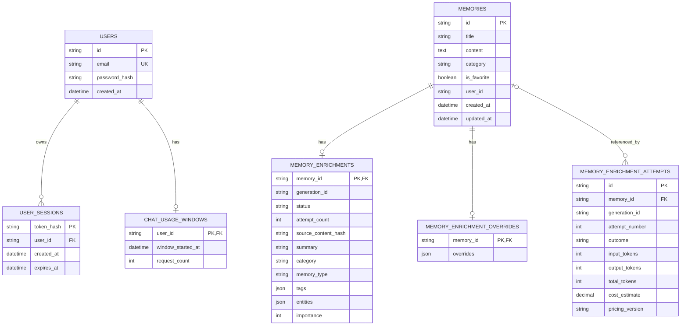

# Aura database schema

PostgreSQL is the supported runtime database. SQLAlchemy models are in `apps/api/app/models/`; ordered schema changes are in `apps/api/migrations/versions/`. SQLite-specific test schemas are not the production schema. Apply migrations from `apps/api/` with `uv run alembic upgrade head`.

## Entity relationships



`MEMORIES.user_id` is indexed but has no database foreign key to `USERS`; ownership isolation is enforced in application queries. User sessions and chat usage windows do use foreign keys to users with `ON DELETE CASCADE`.

## Memory and enrichment tables

| Table                         | Purpose                                                                       | Important constraints and deletion behavior                                                                                                                                                                                                                         |
| ----------------------------- | ----------------------------------------------------------------------------- | ------------------------------------------------------------------------------------------------------------------------------------------------------------------------------------------------------------------------------------------------------------------- |
| `memories`                    | Original title, content, user category, favorite state, and owner ID.         | `id` primary key; `user_id` index. `content` remains user-authored and is not overwritten by enrichment.                                                                                                                                                            |
| `memory_enrichments`          | One current AI generation per memory, including metadata and lifecycle state. | `memory_id` primary key and FK to memories with `ON DELETE CASCADE`; status check; nonnegative attempt count. Stores a SHA-256 source-content hash, not a copy of the content.                                                                                      |
| `memory_enrichment_overrides` | User-authored overrides keyed by metadata field.                              | One row per memory; FK with `ON DELETE CASCADE`; PostgreSQL JSONB. Empty override objects are removed by repository logic.                                                                                                                                          |
| `memory_enrichment_attempts`  | Append-style record for each worker claim/provider attempt.                   | Unique `(generation_id, attempt_number)`; positive attempt number; constrained outcomes and nonnegative token counts. Nullable memory FK uses `ON DELETE SET NULL`, retaining cost/usage history after memory deletion. Indexed on `memory_id` and `generation_id`. |

`MemoryEnrichment` contains `generation_id`, generation and prompt versions, model, status, attempt count, last error code, next retry time, lease expiration, completion time, and structured enrichment metadata. Tags and entities use JSONB in PostgreSQL (JSON in SQLite tests). The current enrichment row is refreshed for a new memory-content generation, while attempt audit rows retain prior generation and pricing snapshots. Attempt `generation_id` is intentionally not a foreign key to the one current enrichment row, because historical attempts must remain valid after that row is assigned a later generation.

Attempt rows record requested/returned model, prompt/schema versions, source hash, outcome, provider status, response/request IDs, provider-reported token details, decimal estimated cost, currency, pricing version, applied per-million rates, and start/response/record timestamps. They do not store memory content. Cost is an estimate, not provider invoice data. No usage aggregation/reporting endpoint is currently exposed.

## Migration history

The migration chain includes initial memory/auth tables, chat usage windows, AI enrichment, retry state, manual overrides, and per-attempt usage/cost auditing. The AURA-61 migration assigns a unique generation ID to every existing enrichment before making it non-null, then adds attempt storage and its integrity indexes. The retry-state migration backfills existing completed enrichment rows with their original creation timestamp as `completed_at`.

Useful inspection and migration commands, run from `apps/api/`:

```bash
uv run alembic current
uv run alembic history
uv run alembic upgrade head
```

Use the isolated migration test instructions in [the API guide](../apps/api/README.md#integration-and-regression-tests) for disposable PostgreSQL validation; never use a development database for destructive migration tests.

## Integrity and data lifecycle notes

- Enrichment claims use transaction locking and a conditional update; PostgreSQL workers use `FOR UPDATE SKIP LOCKED` to coordinate competing API processes.
- Successful metadata writes require the current memory content hash to equal the generation source hash. Content edits queue a new generation; stale provider output is discarded.
- Manual overrides are separate from AI fields and are overlaid by the response layer. They do not modify `memories.content`.
- Deleting a memory cascades its current enrichment and override rows. Attempt rows remain and their `memory_id` becomes null.
- Schema checks are defined both by models/migrations and exercised by SQLite and disposable PostgreSQL tests. PostgreSQL-specific claim/concurrency and migration contract tests skip if their dedicated test URL is not configured.
