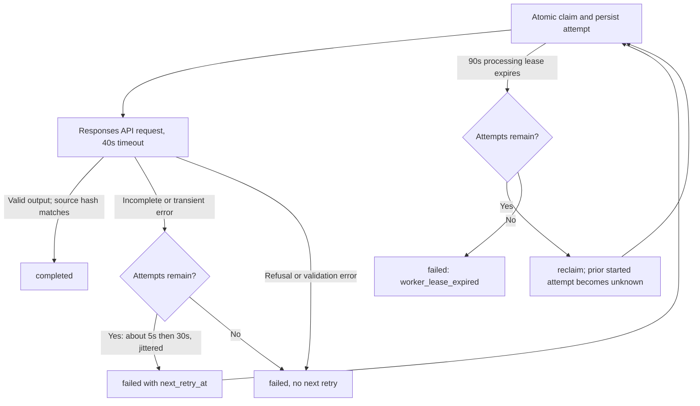

# Aura operations and configuration

This guide describes the supported Python/FastAPI runtime. The TypeScript/Fastify code in `apps/api/src` is legacy and is not a deployment target. Production must use PostgreSQL; Redis is included in local Compose but is not currently used by the application.

## Local development

Requirements: Python 3.13, `uv`, Node.js 22+, pnpm 9, and Docker Compose. From the repository root:

```bash
cp apps/api/.env.example apps/api/.env
docker compose up -d postgres
uv sync --project apps/api --group dev
uv run --project apps/api alembic upgrade head
pnpm install
pnpm dev
```

The API defaults to `http://localhost:8000`; Vite defaults to `http://localhost:5173`. To run the API alone, from `apps/api/` use `uv run uvicorn app.main:app --reload --port 8000`. The API starts its enrichment polling task during FastAPI lifespan startup. There is no separate worker command. Stop with Ctrl+C; lifespan shutdown cancels the poller.

Apply Alembic migrations before starting the service. The example `DATABASE_URL` matches the local Compose PostgreSQL credentials. Never copy production secrets into tracked files; `apps/api/.env` and `apps/web/.env.local` are local-only configuration.

## Environment settings

Settings load from environment variables or `apps/api/.env`; environment variables take precedence. See `apps/api/.env.example` for the full template and defaults.

| Variable                         | Default                 | Runtime behavior                                                                                                                                    |
| -------------------------------- | ----------------------- | --------------------------------------------------------------------------------------------------------------------------------------------------- |
| `ENVIRONMENT`                    | `development`           | `development`, `test`, or `production`; production requires an explicit non-SQLite `DATABASE_URL`.                                                  |
| `DATABASE_URL`                   | Local PostgreSQL URL    | SQLAlchemy URL. Keep credentials in a secret store for hosted deployments.                                                                          |
| `OPENAI_API_KEY`                 | Empty                   | Optional for process startup; configure it for `/chat` and successful AI memory enrichment. Stored as a redacted `SecretStr`.                       |
| `OPENAI_PRICING_VERSION`         | `unconfigured`          | Label copied into each claimed enrichment attempt.                                                                                                  |
| `OPENAI_MODEL_PRICING`           | `{}`                    | JSON object keyed by the exact model name returned by the Responses API. Missing rates make cost estimates unavailable without blocking enrichment. |
| `WEB_ORIGIN`                     | `http://localhost:5173` | Single allowed browser origin for CORS.                                                                                                             |
| `API_PORT`                       | `8000`                  | Documented application port; local uvicorn command passes its port explicitly.                                                                      |
| `LOG_LEVEL`                      | `INFO`                  | Standard Python logging level accepted by settings.                                                                                                 |
| `ACCESS_TOKEN_TTL_SECONDS`       | `86400`                 | Bearer-token lifetime, from 1 through 2,592,000 seconds.                                                                                            |
| `CHAT_RATE_LIMIT_PER_MINUTE`     | `10`                    | Maximum per-user requests per configured window (the name is historical; the value is the count).                                                   |
| `CHAT_RATE_LIMIT_WINDOW_SECONDS` | `60`                    | Rolling chat limit window in seconds.                                                                                                               |
| `CHAT_MAX_INPUT_CHARACTERS`      | `4000`                  | Maximum chat message length.                                                                                                                        |
| `CHAT_MAX_OUTPUT_TOKENS`         | `1000`                  | Maximum output tokens requested for chat completions.                                                                                               |
| `VITE_API_URL`                   | `http://localhost:8000` | Frontend API origin; defined in `apps/web/.env.example`.                                                                                            |

`OPENAI_API_KEY` and `DATABASE_URL` use secret types in application settings. Do not place secrets in logs, issue examples, or committed configuration. Production deployment packaging, secret rotation, and a dedicated worker deployment are not defined in this repository.

`OPENAI_API_KEY` is required for successful provider-backed memory enrichment. The enrichment service does not preflight whether it is configured and does not return a configuration-specific `503`; provider failures flow through the existing enrichment failure lifecycle and are reflected in the persisted enrichment status and attempt history.

## Pricing configuration

Pricing is supplied by deployment configuration rather than hardcoded provider rates. Configure exact returned model identifiers and approved decimal USD rates. Example (replace the model key and rates with approved current values):

```dotenv
OPENAI_PRICING_VERSION=2026-11-approved-rates
OPENAI_MODEL_PRICING={"gpt-5-mini-2026-01-01":{"input_per_million":"0.00","output_per_million":"0.00","cached_input_per_million":"0.00","cache_write_input_per_million":"0.00"}}
```

The example's zero amounts are placeholders, not a provider price recommendation. Input and output rates are required for an estimate. Cached-input and cache-write rates are optional, but if provider usage reports tokens for a category with no configured rate, the attempt's estimate remains null. Rates and version are snapshotted on each attempt so later configuration changes do not alter history. The application distinguishes estimated cost from actual billed cost; actual billing reconciliation is not implemented.

## Worker behavior and recovery

Each API process starts a database polling coroutine in its FastAPI lifespan. It sleeps one second between iterations, marks expired final-attempt leases failed, and claims one eligible row at a time. Memory creation and content changes also enqueue a one-shot FastAPI background task; the database claim prevents it from duplicating the poller's work. No Redis queue or in-memory-only job registry is used.

The states are `pending`, `processing`, `completed`, and `failed`. Jobs have at most three application attempts. Incomplete responses and retryable provider/network failures can retry at approximately 5 and 30 seconds with ±20% jitter; refusal and validation failures terminate. The Responses API request timeout is 40 seconds; leases last 90 seconds. OpenAI SDK automatic retries are disabled.

If a worker exits while processing, the lease makes the job eligible for recovery after expiration. When attempts remain, another claim marks the previous still-started attempt as `unknown` and creates a distinct attempt row. If the final lease expires, the generation becomes failed with `worker_lease_expired`; there is no fourth application attempt. The original memory content is checked against its SHA-256 source hash before and after provider work. Stale output is discarded, but any available provider usage remains recorded.

Monitor API availability with `GET /health`, inspect request IDs with the `X-Request-ID` response header, and inspect enrichment state via the authenticated `GET /memories/{memory_id}/enrichment` endpoint. The endpoint exposes status and retry timing, not attempt-level token/cost history. There is no administrative usage report, worker-specific health endpoint, or separate worker process in the current application.



## Security, CORS, and logs

Bearer tokens are random opaque values; only their SHA-256 hashes are stored. Passwords are PBKDF2-SHA256 hashes. Memory operations and chat require authentication. Keep the API behind HTTPS and an appropriately configured trusted ingress in hosted environments; the repository does not provide a production reverse-proxy or deployment manifest.

CORS allows the configured `WEB_ORIGIN`, credentials are disabled, and methods are limited to `GET`, `POST`, `PATCH`, and `DELETE`. API middleware logs request ID, method, path, status, and duration, and returns `X-Request-ID`. Unexpected errors log the exception type rather than exception text. Request bodies, query strings, bearer credentials, and memory text are excluded from request logs.

## Operational checks

From `apps/api/`:

```bash
uv run alembic current
uv run alembic upgrade head
uv run pytest
uv run ruff check app tests migrations
uv run ruff format --check app tests migrations
```

PostgreSQL migration and concurrent-claim tests use a dedicated disposable database configured with `AURA62_POSTGRES_TEST_URL`; see the safety instructions in the API README before running them.
